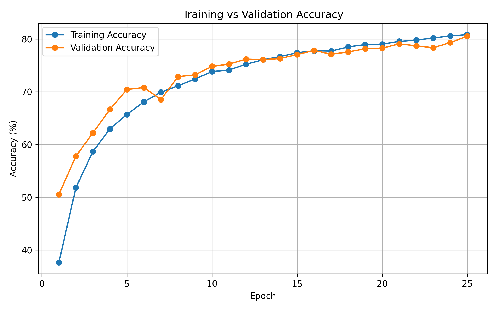
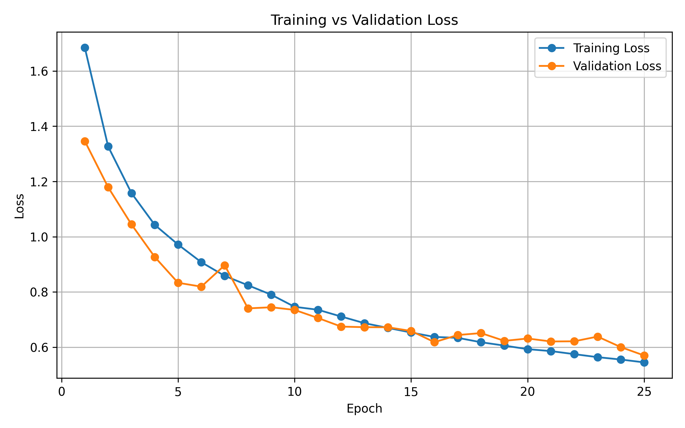
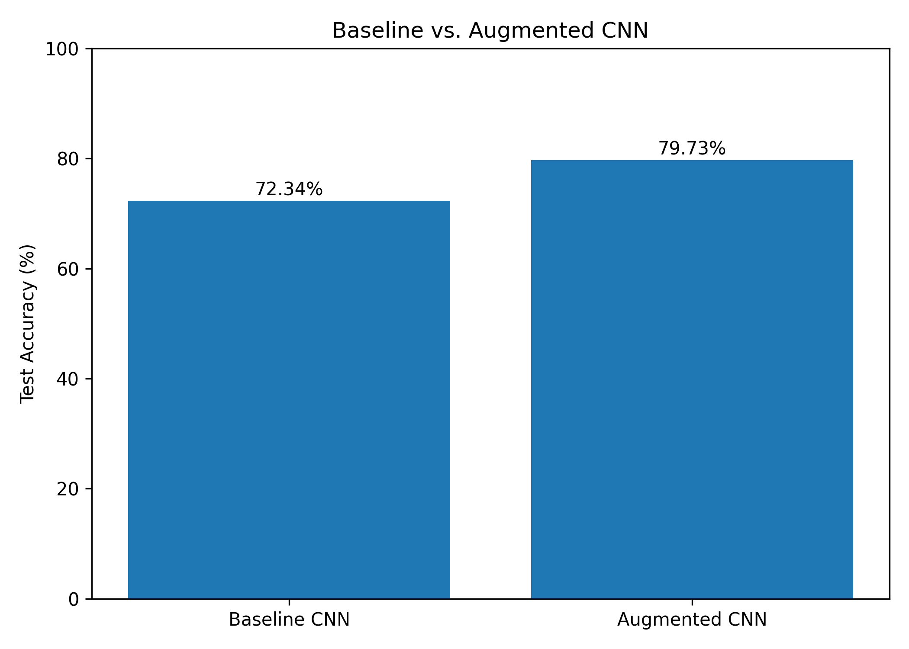
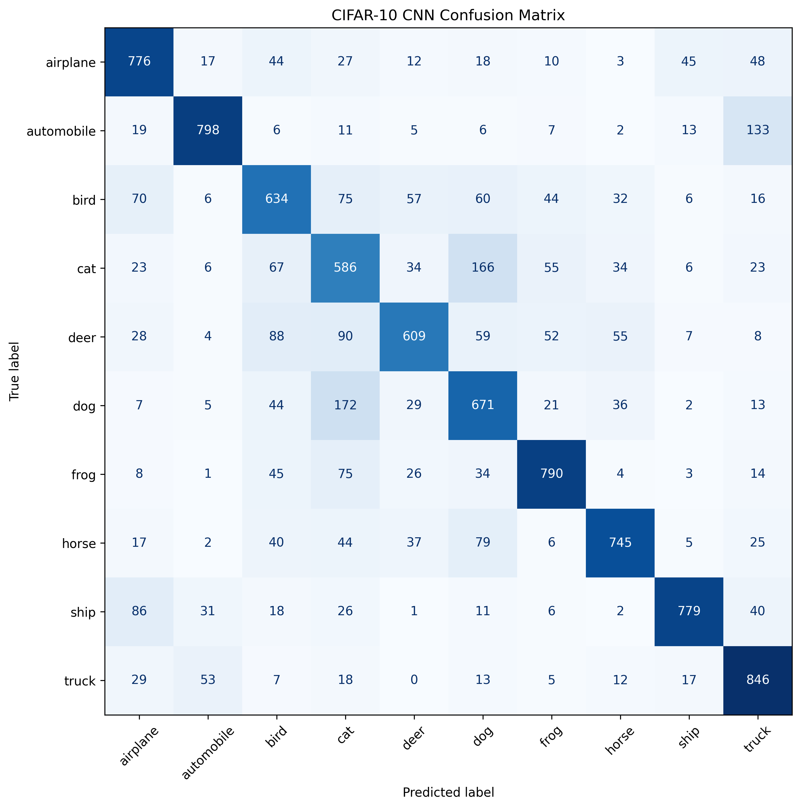
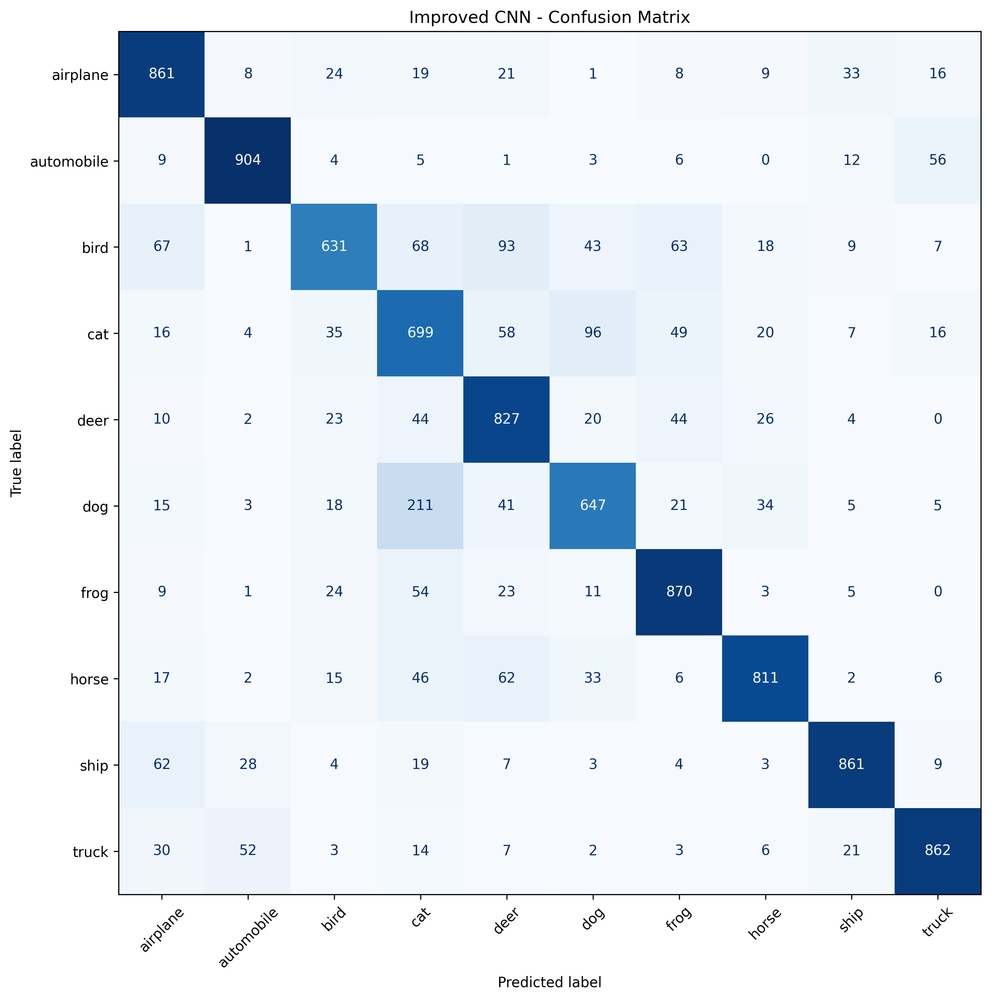

# CIFAR-10 Image Classification with PyTorch

A hands-on deep learning project implementing a three-layer
Convolutional Neural Network (CNN) to classify CIFAR-10 images.
The project explores data augmentation, model checkpointing,
and evaluation on unseen test data.

## Results

| Metric | Baseline CNN | Improved CNN |
|---|---:|---:|
| Data augmentation | No | Yes |
| Training epochs | 15 | 25 |
| Best validation accuracy | 73.92% | 80.54% |
| Test accuracy | 72.34% | 79.73% |

The improved experiment achieved a 7.39 percentage-point
increase in test accuracy. Training duration and random
initialization also differed between experiments, so this
gain cannot be attributed to augmentation alone.

## Dataset

CIFAR-10 contains 60,000 colour images of size 32x32 pixels
across 10 classes:

airplane, automobile, bird, cat, deer, dog, frog, horse,
ship, truck.

- Training pool: 50,000 images
- Training split: 45,000 images
- Validation split: 5,000 images
- Test set: 10,000 images

Torchvision downloads the dataset automatically.

## Model Architecture

- Conv2d: 3 -> 32 channels
- ReLU activation and max pooling
- Conv2d: 32 -> 64 channels
- ReLU activation and max pooling
- Conv2d: 64 -> 128 channels
- ReLU activation and max pooling
- Flatten
- Fully connected layer: 2048 -> 128
- Output layer: 128 -> 10 classes

## Training Configuration

- Framework: PyTorch
- Optimizer: Adam
- Learning rate: 0.001
- Loss function: CrossEntropyLoss
- Batch size: 64
- Improved experiment: 25 epochs
- Augmentation: random crop and horizontal flip

## Visual Results

### Training and Validation Accuracy

### Training and Validation Loss

### Baseline vs Improved Model

### Baseline Confusion Matrix

### Improved Model Confusion Matrix

## Key Learnings

- Building and training a CNN using PyTorch
- Understanding tensors, convolution, pooling, and logits
- Tracking training and validation metrics
- Identifying overfitting
- Using data augmentation to improve generalization
- Saving and loading model checkpoints
- Evaluating class-wise performance with a confusion matrix

## How to Run

1. Clone this repository.
2. Install dependencies using `pip install -r requirements.txt`.
3. Open `CIFAR10_CNN_Learning.ipynb` in Jupyter or Google Colab.
4. Run the notebook cells in order.

The dataset is downloaded automatically through Torchvision.

## Future Improvements

- Add learning-rate scheduling and systematic early stopping.
- Compare multiple random seeds for more reliable results.
- Investigate class-specific errors.
- Explore stronger augmentation and regularization.
- Compare with established CNN architectures.

## Disclaimer

This is an educational project. Reported results correspond to
the experiments documented in the notebook.
